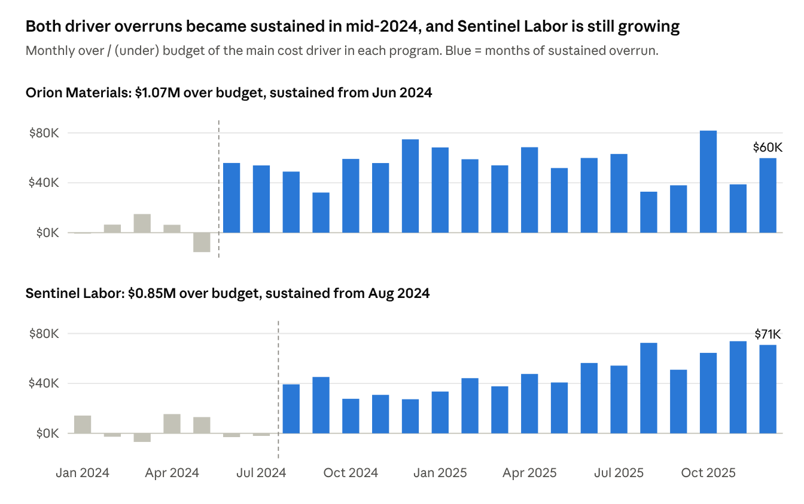

# Aerospace Program Financial & Cost Analysis

**A six-program aerospace portfolio ran $2.62M (1.24%) over budget. Two programs caused 93% of it, each traced to a single cost category and a start month.**

End-to-end analysis for a VP Finance / Program Finance Manager: Excel → SQL → Power BI → findings and recommendations. Built on a synthetic dataset modeled on aerospace program-control and Earned Value Management (EVM) concepts.

<!-- Dashboard screenshot: images/dashboard_portfolio.png (added next) -->

---

## Business problem

Management needed to know:

1. How is the overall portfolio performing against budget?
2. Which programs are driving the overrun?
3. Which cost categories are causing it?
4. When did the problems start?
5. Which programs need management attention?

## Key findings

| # | Question | Finding |
|---|---|---|
| 1 | Portfolio | **$2.62M over budget (1.24%)**, CPI 0.979, status *Monitor* |
| 2 | Programs | **Orion and Sentinel cause 93%** of the net overrun |
| 3 | Cost drivers | **Orion → Materials** ($1.07M, 68.6% of Orion's overrun); **Sentinel → Labor** ($845K, 95.2%) |
| 4 | Timing | Orion Materials sustained from **June 2024**; Sentinel Labor from **August 2024** and still growing (~$30K/month in late 2024 → ~$70K/month in late 2025) |
| 5 | Attention | Orion and Sentinel are *High Attention*. **Atlas** looks under budget but has the **worst CPI (0.954)**, a hidden risk the budget view misses |



### Program summary

| Program | Over / (under) budget | Variance % | CPI | Management Status | CPI Watch |
|---|---:|---:|---:|---|---|
| Orion | $1,557,692 | 3.49% | 0.964 | High Attention | Watch |
| Sentinel | $887,639 | 2.56% | 0.974 | High Attention | Watch |
| Horizon | $190,544 | 0.52% | 0.993 | On Track | On Track |
| Vanguard | $102,836 | 0.40% | 0.991 | On Track | On Track |
| Falcon | ($45,210) | (0.11%) | 1.001 | On Track | On Track |
| Atlas | ($72,050) | (0.24%) | 0.954 | On Track | **Watch** |
| **Portfolio** | **$2,621,451** | **1.24%** | **0.979** | **Monitor** | **Monitor** |

## Recommendations

The data shows *where* and *when* costs ran over, not *why*, so each recommendation is a targeted investigation, ranked by urgency:

1. **Sentinel:** review labor hours vs. rates, staffing, and overtime since August 2024. The overrun is still growing every month.
2. **Orion:** review materials pricing, supplier contracts, and quantities vs. plan since June 2024. It's the largest overrun but steady.
3. **Atlas:** review schedule progress and productivity before its efficiency gap turns into an overrun.
4. **Portfolio:** add an estimate at completion (EAC) to monthly reporting, using the forecast cost data.

Full write-up: [Findings and Recommendations (PDF)](docs/findings_and_recommendations.pdf)

---

## Dataset

Synthetic data, so the project shows realistic financial analysis without using proprietary employer data.

- **864 rows** = 6 programs × 24 months (Jan 2024 – Dec 2025) × 6 cost categories
- **Grain:** Program × Reporting Month × Cost Category
- **Programs:** Falcon, Sentinel, Orion, Atlas, Vanguard, Horizon
- **Cost categories:** Labor, Materials, Subcontracts, Overhead, Travel, Other Direct Costs
- **Columns:** `program_id`, `program_name`, `customer_type`, `program_type`, `program_manager`, `reporting_month`, `cost_category`, `budget_cost`, `actual_cost`, `earned_value`, `forecast_cost`

### Metrics

| Metric | Formula | Reading |
|---|---|---|
| Budget Variance | Actual − Budget | Positive = over budget |
| Budget Variance % | Budget Variance ÷ Budget | Compares programs of different sizes |
| Cost Variance | Earned Value − Actual | Negative = less work delivered than paid for |
| CPI | Earned Value ÷ Actual | Below 1.00 = unfavorable |

## Approach

Each tool checked the one before it.

| Step | Tool | What I did |
|---|---|---|
| 1 | **Excel** | Validated the 864 rows, added variance and CPI columns, and used PivotTables to find the first drivers (Orion Materials, Sentinel Labor) |
| 2 | **SQL (MySQL)** | Built a reusable view (`vw_program_financial_metrics`) with NULL-safe denominators; ran program, category, and monthly rollups; wrote `CASE` logic for Management Status |
| 3 | **Power BI** | Fact table + marked date table model; 16 DAX measures in display folders; one-page dashboard that drills Portfolio → Program → Cost Category → Month, with status-colored KPIs and a program slicer |
| 4 | **Findings** | Management memo with findings, ranked recommendations, and limitations |

### Validation

Power BI was checked against the SQL results before any visual was built:

| Check | SQL | Power BI |
|---|---|---|
| Portfolio variance | $2,621,450.89 | $2,621,450.89 ✅ |
| Orion variance | $1,557,692.49 | $1,557,692.49 ✅ |
| Sentinel variance | $887,638.70 | $887,638.70 ✅ |
| Orion Materials share | 68.6% | 68.6% ✅ |
| Sentinel Labor share | 95.2% | 95.2% ✅ |

## AI-assisted workflow

I used **Claude** (Anthropic) with **Microsoft's official Power BI authoring tools** to build the Power BI layer faster: the DAX measures, model checks, and dashboard visuals.

My role was the analysis: I defined the business questions, built the Excel and SQL analysis, set the Management Status thresholds, decided to add the CPI Watch indicator (which surfaced Atlas), set the recommendation priorities, and checked every Power BI result against my SQL benchmarks before accepting it.

## Repository structure

```
├── README.md
├── data/      program_financials.csv            Source dataset (864 rows)
├── excel/     aerospace_program_financial_analysis.xlsx   Calculated columns + PivotTables
├── sql/       aerospace_program_financial_cost_analysis.sql   Validation, view, rollups, CASE logic
├── powerbi/   Aerospace_Program_Financial_Cost_Analysis.pbix  Model + dashboard
│              dax_measures.md                   All DAX measures, readable without Power BI
├── docs/      findings_and_recommendations.pdf  Management memo
└── images/    Dashboard and chart screenshots
```

**To explore:** open the `.pbix` in [Power BI Desktop](https://www.microsoft.com/power-bi/desktop) (free), run the `.sql` file in MySQL after importing `data/program_financials.csv` as `program_financials`, or open the `.xlsx` in Excel.

## Limitations

- **Synthetic data:** the findings demonstrate the method, not a real company's results.
- **No root-cause fields:** no hours, rates, unit prices, or supplier data, so the analysis locates overruns but can't explain them.
- **Illustrative thresholds:** the 2.5% / 1.0% budget bands and 0.975 / 0.990 CPI bands are project choices, not industry standards.
- **Backward-looking:** forecast cost wasn't yet used to project where programs will finish.

## Skills demonstrated

Business problem framing · data validation · Excel PivotTables · SQL views, aggregation, and `CASE` logic · variance and Earned Value analysis · Power BI data modeling · DAX · dashboard design · root-cause and trend analysis · management reporting · AI-assisted development

---

**Jordan Dille** · [GitHub](https://github.com/JordanDille01)
